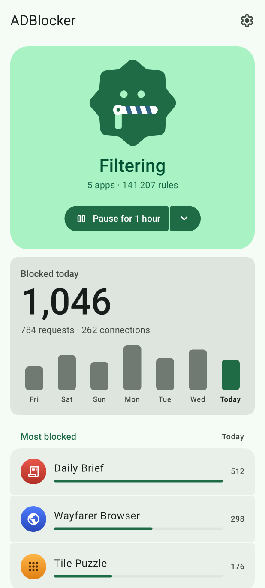
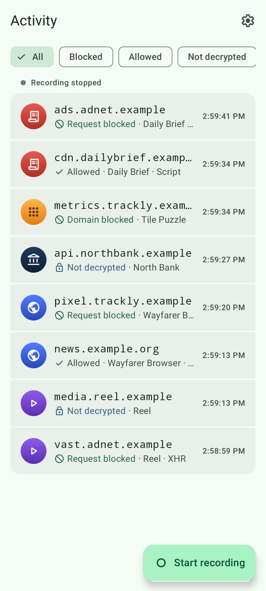

# ADBlocker

English | [简体中文](README.zh-CN.md)

ADBlocker blocks ads and trackers in Android apps using standard browser filter
lists such as EasyList, uBlock Origin, and AdGuard. Filtering runs locally on
your device, either through a root module or a local VPN. You can filter
selected apps or all personal apps. ADBlocker only downloads the lists you
subscribe to and sends no telemetry.

  
  
  
  

## Root mode vs. VPN mode

ADBlocker automatically chooses its filtering method based on whether root
access is available:

| | Root mode | VPN mode |
| --- | --- | --- |
| Requirements | Root access | No root |
| Android VPN slot | Free for another VPN app | Used by ADBlocker |
| HTTPS URL filtering | Filtered personal apps; work apps need the profile admin to install the CA | Apps that trust user certificates (after installing ADBlocker's CA) |
| DNS filtering | Plain DNS lookups from filtered apps | DNS queries from filtered apps |
| Per-app attribution | Preserved by Android (works alongside VPN and firewall per-app rules) | Counted under ADBlocker |

Root mode does not modify `/system`, uses no `post-fs-data` script or SELinux
rules, and fails open: if the daemon stops, traffic resumes through Android's
normal network path.

## Requirements

Both modes require a 64-bit ARM (`arm64`) or x86 (`x86_64`) device.

- **Root mode**: Android 12 or later, a GKI kernel (5.10 or newer), and root
  access—for example via [KernelSU](https://kernelsu.org),
  [Magisk](https://github.com/topjohnwu/Magisk), or
  [APatch](https://apatch.dev). With other root solutions, ADBlocker starts
  root mode itself on boot (enable auto-start if your ROM restricts background
  boot launches).
- **VPN mode**: Android 10 or later.

## Installation

1. Download `adblocker-<version>.apk` from
   [Releases](https://github.com/lihenggui/ADBlocker/releases) and install it.
2. Open ADBlocker and pick the apps and filter lists you want.
   - **With root**: ADBlocker sets up root mode directly—filtering starts
     immediately without rebooting and restarts automatically after each boot.
   - **Without root**: ADBlocker switches to VPN mode and asks for VPN
     permission.

To build from source, see [CONTRIBUTING.md](CONTRIBUTING.md#building).

> **MIUI / HyperOS note:** Some ROMs hide installed apps until ADBlocker is
> granted permission to read the app list. Onboarding and **Apps** prompt for
> this permission and link straight to system settings. In VPN mode, **All
> apps** can only filter apps visible to ADBlocker.

### Installing as a root module

`adblocker-<version>.apk.zip` is the exact same package under a second filename
for root managers. Flash it in KernelSU, Magisk, or APatch if you prefer to
manage root mode inside your root manager; this also attempts to install the
app.

- **KernelSU** applies the module immediately.
- **Magisk** and **APatch** apply it after a reboot. If you open ADBlocker
  before rebooting, it sets up root mode on its own, and the flashed module
  takes over seamlessly with the same settings after the restart.

### Updating

Install the new APK over the existing app and open ADBlocker to update root
mode. If you installed ADBlocker as a root manager module, you can also flash
the new `.apk.zip` directly in your root manager.

### Uninstalling

- **Root mode (app-managed)**: Open **Settings › Remove root mode** before
  uninstalling the app. This stops filtering and deletes the local certificate
  authority (CA) and all module data.
  - If you uninstall the app first, filtering stops within about a minute. On
    KernelSU, Magisk, or APatch, leftover files and data are cleaned up on the
    next reboot. With other root providers, those files—including the CA—stay
    behind unless removed in Settings first.
- **Root mode (root manager module)**: Remove the module in your root manager
  and reboot, then uninstall the app.
- **Work profile CA**: Ask the work profile administrator to remove any CA
  installed for work apps.
- **VPN mode**: If you installed ADBlocker's certificate, open **Settings ›
  Remove the certificate** before uninstalling. Uninstalling deletes the
  private key and app data, while Android keeps the certificate in the user
  store separately.

## Usage

- **Overview**: Check filtering status and blocked counts, pause or resume
  filtering, and download any enabled list that has not been fetched yet.
- **Apps**: Choose **Chosen apps** (default) or **All apps** under **Filtering
  scope**, and view how each app is filtered. In **All apps**, newly installed
  personal apps are filtered automatically; use **Exclude** or **Include** for
  exceptions. ADBlocker itself and system UIDs are never filtered, and work
  apps always use individual selections.
- **Filters**: Manage subscribed lists, custom rules (**My rules**), and
  trusted sites.
- **Activity**: Start a recording, switch to a filtered app to reproduce an
  issue, then stop recording to inspect how each request was handled. Open any
  allowed request to block its domain in that app or in all apps (shared UID
  groups can only be blocked across all apps). Recordings keep up to the latest
  500 requests in memory only—nothing is written to disk.

A **Quick Settings** tile pauses or resumes filtering (and starts the VPN in
VPN mode) after unlocking the device. **Settings** provides HTTPS filtering
setup and a shortcut to Android's "Always-on VPN" setting.

## Filtering capabilities

### Domain, URL, and DNS filtering

- **URL filtering** is enabled by default and applies request-level rules
  wherever available—blocking `news.example/ads/banner` while allowing
  `news.example/articles/today`. Plain HTTP/1 on port 80 needs no certificate.
  For HTTPS over TCP, root mode exposes its local CA only to filtered personal
  apps; VPN mode requires installing the certificate in Settings, and only apps
  that trust user certificates accept it. Until HTTPS inspection is available,
  connections stay encrypted and only domain rules apply. Turn off **URL
  filtering** in **Settings** to filter every app by domain only.
- **Path-level exceptions and substitutes**: With URL filtering on, a host
  blocked by a list stays reachable if an exception allows specific paths, so
  the engine inspects individual requests instead of refusing the connection.
  When a rule specifies a bundled substitute for a blocked request, ADBlocker
  serves it locally and counts the request as blocked.
- **QUIC fallback**: ADBlocker refuses QUIC from active filtered apps so they
  fall back to TCP, where standard HTTPS rules apply. Apps that require QUIC
  may fail to connect.
- **DNS filtering**: Both modes filter plain DNS queries from active filtered
  apps (see [Limitations](#limitations) for Private DNS and DoH).

### Page element hiding and rule syntax

**Hide page elements** is enabled by default on decrypted pages and can be
turned off in **Settings** (or via `abd cosmetic off`). Supported rule
capabilities include:

- **Cosmetic and HTML filtering**: Standard CSS element hiding (`##`),
  procedural filters such as `:has-text()`, AdGuard CSS injection, and
  pre-load HTML element removal (`$$`, compatible uBlock Origin `##^`).
- **Scriptlets and JavaScript rules**: Bundled uBlock Origin and compatible
  AdGuard scriptlets, plus AdGuard JavaScript rules from trusted catalog lists
  and custom rules (disabled on matching pages by `$jsinject`).
- **Request and response rewriting**: `$replace`, `$jsonprune`, `$hls`,
  `$removeheader`, and `$urltransform` (from custom rules and trusted catalog
  lists), plus `$cookie`, `$removeparam`, and `$csp` from any list.
- **App and IP rules**: Per-app targeting with `$app=` (package names, `*`
  prefixes, or `/regex/`), IP/port rules with `$network`, and nested `!#if` /
  `!#else` / `!#endif` conditionals.

See [docs/how-it-works.md](docs/how-it-works.md#filtering) for exact syntax,
matching behavior, and trusted-list rules.

### Filter lists

ADBlocker supports EasyList, uBlock Origin, and AdGuard filter lists. During
setup, it suggests general lists along with regional lists matched to your
system language, locale region, or single-country time zone (for example,
EasyList China, AdGuard Chinese, AWAvenue Ads Rule, and anti-AD for Chinese
locales or mainland China, Hong Kong, Macau, and Taiwan).

Subscriptions update in the background on a schedule. Lists use their
appropriate upstream builds (Android builds for AdGuard Base, AdGuard Chinese,
and AdGuard Mobile Ads; uBlock Origin build for AdGuard Tracking Protection;
AdGuard Base already includes EasyList). Active `!#include` directives are
followed only within the list's HTTPS origin and directory; if a required file
fails to download, the previous copy stays active.

### Shared UIDs and work profiles (root mode)

- **Shared UIDs**: Apps sharing an Android UID in the same profile share one
  switch, pause state, activity feed, and statistics. Enabling any member
  enables the group, and future members inherit its state.
- **Work profiles**: Work copies of apps appear in **Apps** with a briefcase
  icon and keep independent selections, pauses, activity, and counts. Choices
  persist while a work profile is paused and are cleared if the profile is
  deleted. Domain filtering works out of the box; for HTTPS URL filtering,
  export the public certificate from the work app's HTTPS setup and have the
  profile administrator install it (the app must also trust user certificates
  for the target host). See [work profile trust](SECURITY.md#work-profiles).

## Security and privacy

All filtering and HTTPS inspection happen locally on your device. ADBlocker
sends no telemetry and does not log visited hosts or addresses by default.

When **URL filtering** decrypts an HTTPS connection, the app or browser sees
ADBlocker's local certificate rather than the site's original certificate, so
some browser checks (such as Certificate Transparency and built-in pins) no
longer apply. Connections to sensitive sites on the exclusion lists (such as
banks and payment services), sites using Extended Validation (EV) certificates,
and hosts pinned by an app stay encrypted and fall back to domain filtering.

Read [SECURITY.md](SECURITY.md#what-using-it-changes) for the full threat
model and details on [page element hiding](SECURITY.md#hiding-page-elements).
Turn off **URL filtering** in **Settings** at any time to keep all HTTPS
traffic encrypted.

## Limitations

### General

- Plaintext HTTP filtering covers standard HTTP/1 requests on port 80.
- Rules cannot separate ads from legitimate content served from the exact same
  URL.
- Sensitive sites on exclusion lists, sites with EV certificates, and apps
  using certificate pinning stay encrypted and use domain rules only.
- Under **Hide page elements**, procedural rules match elements added
  dynamically after page load, while generic CSS rules based only on a class or
  ID may miss them.

### Root mode

- Plain DNS filtering covers unencrypted DNS lookups from filtered apps.
  Queries sent through Android's Private DNS (always when a provider hostname
  is set; in Automatic mode when the network supports it) or an app's own
  encrypted DNS (such as DoH) are not filtered. Android may also answer from
  its shared resolver cache if another app recently looked up the same domain.
  With URL filtering on, a domain whose HTTPS traffic can be inspected is
  blocked at DNS only if no web exception could apply to it; otherwise
  individual requests are filtered.
- Refuses all UDP traffic to port 443 from active filtered apps, including
  non-QUIC protocols.
- `$network` address rules apply to captured TCP connections on ports 80 and
  443 (including when URL filtering is off).
- Supports the primary user and its managed work profiles, not secondary users.

### VPN mode

- Occupies Android's single VPN slot—starting another VPN stops ADBlocker.
- Android counts filtered apps' traffic under ADBlocker's data usage.
- Most third-party apps trust only system certificates and therefore receive
  domain filtering rather than URL filtering.
- Filters DNS queries sent through the system resolver (including non-HTTP
  traffic). Strict Private DNS and app-level encrypted DNS (such as DoH) bypass
  it.
- Refuses recognized QUIC Initial packets on any UDP port for active filtered
  apps unless exempted by a `$network` address rule.
- `$network` address rules cover both TCP and UDP destinations (including when
  URL filtering is off). For allowed TCP addresses, the VPN opens the upstream
  connection before reading the hostname; if a domain rule blocks the host, it
  closes the connection without sending application data.

## FAQ

### Should I install the APK or flash the module in my root manager?

Both filter identically and share the same data in `/data/adb/adblocker`.
Flashing `.apk.zip` additionally registers ADBlocker in your root manager,
where it only filters while enabled. In either case, you manage apps and lists
inside the ADBlocker app.

### A filtered app stopped working

Open the app in **Apps**, pause filtering for an hour, and try again. If that
resolves the issue, leave filtering off for that app—or resume filtering, start
a recording in **Activity**, and repeat the failing action. Stop the recording
and open blocked requests to inspect which rule matched, allow the domain for
that app or all apps, or delete a custom rule from **My rules** (you can also
tap **Undo** right after changing a rule). When reporting a broken app, include
its name.

### An app keeps rejecting HTTPS filtering

Apps that enforce certificate pinning reject ADBlocker's local CA and fall back
to domain filtering. Their entry in **Apps** lists affected hosts under
**Domains that reject the certificate**.

In root mode with LSPosed/Vector, enable ADBlocker's hook module for that app
and restart it: ADBlocker retries those hosts on app launch and filters them by
URL afterwards. LSPosed/Vector is only needed for pinned apps, and the app must
remain enabled in **Apps**. Hosts refused less than a minute earlier are not
retried immediately, and an opened connection that the app never uses counts as
a refusal—so a host may need one more restart a minute later. See
[limits of HTTPS inspection](SECURITY.md#limits-of-https-inspection).

### Can I use another VPN or a proxy module alongside ADBlocker?

- **Root mode**: Yes. Android's VPN slot remains free for apps such as Clash
  Meta, and outbound connections keep the original app's UID so per-app VPN or
  proxy rules continue to work. If a specific combination loses connectivity,
  please open an issue with the details.
- **VPN mode**: No—Android allows only one active VPN at a time, and proxy
  modules see filtered traffic as coming from ADBlocker. Note that if Android's
  "Block connections without VPN" setting is enabled, selected apps lose
  network access whenever ADBlocker's VPN is stopped.

### Battery use

HTTPS inspection decrypts and re-encrypts traffic on the device; domain-only
filtering avoids this overhead. In VPN mode, packets from selected apps also
pass through ADBlocker's userspace tunnel.

### Where is data stored?

- **Root mode**: `/data/adb/adblocker` (readable only by root).
- **VPN mode**: ADBlocker's private app storage.

Root command-line reference

Run `abd` in a root shell to manage root mode:

- App-managed root mode: `/data/adb/adblocker_direct/bin/abd`
- Root manager module: `/data/adb/modules/adblocker/bin/abd`

The examples below abbreviate this path to `abd`. Most commands accept `--json`
for machine-readable output. Run `abd` with no arguments for the full command
list.

| Command | Description |
| --- | --- |
| `abd status` | Show daemon status and current filtering configuration. |
| `abd scope chosen\|all` | Set the personal filtering scope. |
| `abd app add <package>` | Explicitly select an app. |
| `abd app remove <package>` | Remove an explicit selection. |
| `abd app exclude <package>` | Exclude a personal app from All apps. Use `abd app include <package>` to restore it. |
| `abd app list` | List apps in scope. Use `--json` for effective filtering levels and availability. |
| `abd app selections --json` | Show the scope, saved selections, and exclusions. |
| `abd app eligibility --json` | List personal app eligibility and members of each named group. |
| `abd app profiles --json` | List work profile serials, eligible packages, and shared UID groups. |
| `abd ca export` | Print the public CA certificate for a work profile administrator. |
| `abd app pause <package> --minutes <n>` | Pause filtering for one app. Use `abd app resume <package>` to resume early. |
| `abd pause [--minutes <n>]` | Pause filtering for all apps. Use `abd resume` to resume early. |
| `abd url-filtering on\|off` | Enable or disable URL filtering for all filtered apps. |
| `abd cosmetic on\|off` | Enable or disable page element hiding on decrypted pages (on by default). |
| `abd allow add <host>` | Exempt a host and its subdomains from blocking and decryption. Manage with `abd allow remove <host>` and `abd allow list`. |
| `abd lists` | List filter list subscriptions. |
| `abd list add <url>` | Subscribe to a list. Manage with `abd list remove\|disable\|enable <url>`. |
| `abd update` | Download filter lists. |
| `abd rules get` | Print custom rules. Use `abd rules set` to replace them from standard input. |
| `abd rules append [--unique]` | Append rules from standard input. With `--unique`, add a single rule only if absent. |
| `abd rules remove` | Remove exact rule lines supplied on standard input (ignoring surrounding whitespace). |
| `abd rules check` | Validate custom rules from standard input and report the class and reason for each unapplied line. |
| `abd pinned` | List hosts whose local certificate an app rejected. Use `abd pinned forget <package> [<host>]` to retry decryption later. |
| `abd reload` | Reload lists, rules, and app selections. |
| `abd stats` | Show filtering statistics. |
| `abd check [--app <package>] <url>` | Test whether the lists block a URL and show the matching list. With `--app`, app-specific rules apply as well. |

**Addressing work apps and shared UIDs:**

- For a work app, use `<profile-serial>:<package>` (for example,
  `abd app add 10:com.example.news`). Use the serial from
  `abd app profiles --json`, which may differ from the Android user ID.
- For a shared UID, pass either a member package or the group key (for example,
  `abd app pause 10:@com.example.shared --minutes 15`).

**Configuration files in `/data/adb/adblocker`:**

- `sources`: Subscribed filter list URLs, one per line. Until subscriptions are
  saved, `sources` does not exist and ADBlocker uses the general and matching
  regional defaults. Any default list omitted from `sources` remains enabled;
  prefix its URL with `#` to disable it.
- `exclusion-sources`: Lists of hosts that are never decrypted, one per line.
  Updates add missing bundled exclusion sources to an existing selection; an
  empty selection keeps decryption off.
- `rules/*.txt`: Custom filter rules. Run `abd update` or `abd reload` after
  manual edits.

## How it works

In root mode, ADBlocker resolves the sending app's UID before passing a
connection to the filter and connects upstream using that same app's network
identity. In VPN mode, the same Rust filtering engine runs inside the app over
a userspace TCP/IP stack. Follow a connection end-to-end—from kernel routing
and HTTPS verification to the [adblock-rust](https://github.com/brave/adblock-rust)
rule engine—in [docs/how-it-works.md](docs/how-it-works.md).

## Languages

ADBlocker is available in English, Simplified Chinese, Traditional Chinese,
French, German, Indonesian, Japanese, Korean, Brazilian Portuguese, Russian,
Spanish, Turkish, and Vietnamese. It follows the system language, and on
Android 13 or later you can pick a separate language under Android's "App
languages" settings. Translation fixes from native speakers are welcome—see
[docs/translations.md](docs/translations.md) for terminology and verification
checks.

## Contributing

Bug reports and pull requests are welcome. Please read
[CONTRIBUTING.md](CONTRIBUTING.md) for build steps, tests, and conventions, and
follow our [Code of Conduct](CODE_OF_CONDUCT.md).

## License

Copyright (C) 2026 Mercury Li

This program is free software: you can redistribute it and/or modify it under
the terms of the GNU General Public License version 3 as published by the Free
Software Foundation. See [LICENSE](LICENSE).

Filter lists and
[AdGuard HTTPS exclusions](https://github.com/AdguardTeam/HttpsExclusions) are
downloaded from their respective maintainers. AdGuard declares the exclusions
project under MIT in its
[`package.json`](https://github.com/AdguardTeam/HttpsExclusions/blob/master/package.json).
See [THIRD_PARTY_NOTICES.md](THIRD_PARTY_NOTICES.md) for upstream attributions
and license materials distributed with releases.
