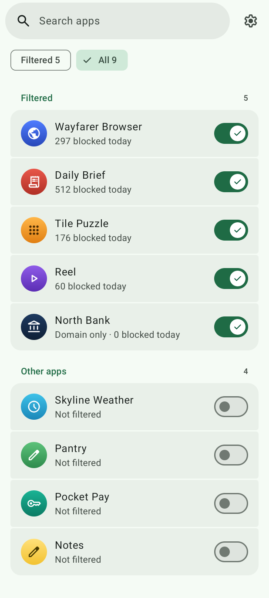
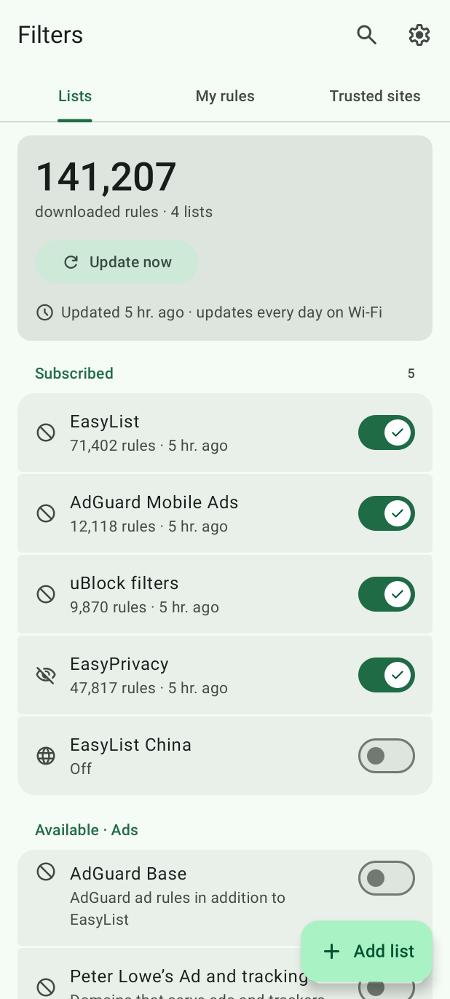

# ADBlocker

ADBlocker blocks ads and trackers in Android apps with the filter lists
of browser ad blockers, such as EasyList, uBlock Origin and AdGuard. You
choose the apps it filters, or let it filter all of your personal apps.
ADBlocker downloads the lists you subscribe to and sends no telemetry.

  
  
  
  

ADBlocker filters in one of two ways, depending on whether the device is
rooted:

| | Root mode | VPN mode |
| --- | --- | --- |
| Needs | Root with KernelSU, Magisk or APatch | No root |
| Android's VPN slot | Stays free for another VPN | Used by ADBlocker |
| HTTPS filtering by URL | Filtered personal apps; work apps need their administrator to install the CA | Apps that trust user certificates, once you install ADBlocker's |
| DNS filtering | Plain DNS lookups from filtered apps | Queries from filtered apps |

In root mode, Android still attributes each connection to the app that
made it, so per-app VPN and firewall rules keep working. In VPN mode, the
filtered apps' traffic passes through ADBlocker's process, and Android
counts its data usage under ADBlocker.

## What it filters

In **Filtering scope**, keep **Chosen apps** to select them individually, or
choose **All apps** to filter eligible personal apps, including new installs.
Use **Exclude** or **Include** on the **Apps** page to make exceptions.
ADBlocker and system UIDs stay outside the filter. Work apps still use
individual choices.

**URL filtering** is on by default and applies URL and resource rules to
every filtered app where possible. A rule can then block
`news.example/ads/banner` while allowing `news.example/articles/today`.
Ordinary HTTP/1 on port 80 needs no certificate. For HTTPS over TCP, the
module makes its local CA available to filtered personal apps in root mode.
In VPN mode, install the certificate through Settings; only apps that trust
user-installed certificates accept it. Until then, HTTPS stays encrypted
and only domain rules apply. Turn off **URL filtering** in Settings to
filter every app by domain only. See
[how this affects certificate trust](SECURITY.md#what-using-it-changes).

With URL filtering on, a host that a list blocks but also allows for
some paths stays reachable: the engine checks each request on the
connection instead of refusing it. When a site or app requires a
certificate ADBlocker cannot use, HTTPS stays encrypted and only domain
rules apply.

ADBlocker refuses QUIC for selected apps so they can retry over TCP, where
the usual HTTPS rules apply. Apps that only support QUIC may fail to connect.

In Root mode, apps that Android puts in the same shared UID group have one
switch per profile. Switching on any member enables filtering for the group.
New members inherit its selection and pause. Activity and statistics
are counted once for the group.

### Work apps with root

On the Apps page, a briefcase marks the work copy of an app. Each copy
has its own selection, pause, activity and statistics. If Android cannot
list a work profile's apps for a moment, retry from the Apps page; the
other apps stay manageable meanwhile. The module keeps your choices while
a work profile is paused. Deleting the work profile clears its selections
and pauses, and a newly created profile starts with none.

Domain filtering needs no certificate. For HTTPS request filtering, keep
URL filtering on, open the work copy's certificate setup, and give the
public certificate to the profile administrator to install in that
profile. The work app must also trust user certificates for the
destination. The app's details show how its HTTP and HTTPS traffic is
filtered.
See [work profile trust](SECURITY.md#work-profiles).

## Requirements

Both methods require a 64-bit ARM (arm64) or x86 (x86_64) device.

- Root mode: Android 12 or later, a GKI kernel (5.10 or newer), and root
  with module support: [KernelSU](https://kernelsu.org),
  [Magisk](https://github.com/topjohnwu/Magisk) or
  [APatch](https://apatch.dev).
- VPN mode: Android 10 or later.

## Installation

Download from [Releases](../../releases). `adblocker-<version>.apk.zip`
and `adblocker-<version>.apk` are the same package, which contains both
the Android app and the root module, under two names. To build it
yourself, see the [build instructions](CONTRIBUTING.md#building).

- **With root**, install the `.apk.zip` as a module in your root manager.
  This also attempts to install the app. Alternatively, install the
  `.apk` and follow the root setup in ADBlocker.
- **Without root**, install the `.apk`. Open ADBlocker, choose your apps
  and lists, and grant VPN permission.

Setup suggests the general lists and the regional lists for the
languages of the device, such as EasyList China, AdGuard Chinese and
AWAvenue Ads Rule for Chinese.

KernelSU applies the module immediately. Magisk and APatch require a
restart. ADBlocker saves the selected subscriptions, downloads the lists,
and updates them in the background at the configured interval. To download
lists from a root shell, run `abd update`.

### Uninstalling

With root, remove the module in the root manager, restart the device, and
uninstall the app. Have the work profile administrator remove any CA installed
for work filtering. Removing the module deletes its certificate authority
and its other data.

In VPN mode, if you installed ADBlocker's certificate, follow **Settings ›
Remove the certificate** before uninstalling the app. Uninstalling deletes the
private key and the app's data. Android stores the certificate separately.

## Usage

- **Overview** shows filtering status and blocked requests. Use it to
  pause or resume filtering.
- **Apps** lists installed apps and how each is filtered.
- **Filters** manages subscriptions, custom rules, and trusted sites.
  Supported lists include EasyList, uBlock Origin lists, and AdGuard lists.
- **Activity** records requests when you start a recording. Switch to
  the filtered app, repeat the action you want to check, and stop the
  recording to see how the current rules treat each request. The latest
  500 requests stay in memory until the next recording or until
  ADBlocker exits.

The Quick Settings tile pauses and resumes filtering, and in VPN mode
starts the VPN. Settings links to Android's Always-on VPN setting and
holds the HTTPS filtering setup.

Root command-line reference

Run `/data/adb/modules/adblocker/bin/abd` in a root shell to manage the
module. The examples below abbreviate this path to `abd`.

| Command | What it does |
| --- | --- |
| `abd status` | Show the daemon's status and current filtering configuration. |
| `abd scope chosen\|all` | Set the personal filtering scope. |
| `abd app add <package>` | Make an explicit selection. |
| `abd app exclude <package>` | Keep a personal app out of All apps. Use `app include` to restore it. |
| `abd app remove <package>` | Remove an explicit selection. |
| `abd app list` | List apps in scope. Use `--json` to see effective filtering levels and availability. |
| `abd app selections --json` | Show the scope, saved choices and exclusions. |
| `abd app eligibility --json` | List personal app eligibility and the members of each named group. |
| `abd app profiles --json` | List work profile serials, eligible packages and shared UID groups. |
| `abd ca export` | Print the public CA certificate for a work profile administrator. |
| `abd app pause <package> --minutes <n>` | Pause filtering for one app. Use `abd app resume <package>` to resume early. |
| `abd pause [--minutes <n>]` | Pause filtering for all apps. Use `abd resume` to resume early. |
| `abd url-filtering on\|off` | Enable or disable URL filtering for all filtered apps. |
| `abd cosmetic on` | Hide matching elements on decrypted pages. This is off by default. Use `off` to disable it. |
| `abd allow add <host>` | Exempt a host and its subdomains from blocking and decryption. Manage entries with `abd allow remove <host>` and `abd allow list`. |
| `abd lists` | List the filter lists. |
| `abd list add <url>` | Subscribe to a list. Use `remove`, `disable`, or `enable` with the same URL to manage it. |
| `abd update` | Download the filter lists. |
| `abd rules get` | Print custom rules. Use `abd rules set` to replace them from standard input. |
| `abd rules append [--unique]` | Append rules from standard input. With `--unique`, add a single rule only if absent. |
| `abd rules check` | Report which rules from standard input the engine cannot apply. |
| `abd pinned` | List hosts for which an app has rejected the local certificate. Use `abd pinned forget <package> [<host>]` to retry decryption on a later connection. |
| `abd reload` | Read the lists, rules and apps again. |
| `abd stats` | Show filtering statistics. |
| `abd check <url>` | Check whether the lists block a URL and identify the matching list. |

For a work app, use `<profile-serial>:<package>` wherever a command takes
an app, for example `abd app add 10:com.example.news`. Use the serial
reported by `abd app profiles --json`, which can differ from the Android
user ID.

For a shared UID, either a member package or the group key identifies the
selection. For example, `abd app pause 10:@com.example.shared --minutes 15`
pauses the group in work profile 10.

Most commands accept `--json` for the output format used by the app.
Run `abd` without arguments for the full command list.

In `/data/adb/adblocker`, `sources` holds the addresses of the filter lists
and `exclusion-sources` those of the lists of hosts that are never
decrypted, one a line. Until the filter lists are chosen, there is no
`sources`, and the lists are the general ones and the regional lists for
the system language (`persist.sys.locale`). One of these that `sources`
does not name is on, and `#` before its address turns it off. Updates add missing bundled exclusion sources to
an existing selection. An empty exclusion selection keeps decryption off.
Custom rules go in `rules/*.txt`, in the syntax of the filter lists. A
rule ending in `$app=` and a package name, such as
`||ads.example^$app=com.reader`, applies in that app only. Run
`abd update` or `abd reload` after a change.

## FAQ

### A filtered app stopped working

Open the app's entry in **Apps**, pause filtering for an hour, and try
again. If that fixes the problem, you can leave filtering off for that app.
To find the rule involved, resume filtering, start a recording in
**Activity**, and repeat the action that failed. Stop the recording and
open a blocked request to see its details or allow a site you trust.
If you report the problem, include the name of the affected app.

### An app keeps rejecting HTTPS filtering

Some apps accept only their own certificate for a site, and ADBlocker
then filters them by domain only. The app's entry in **Apps** lists these
sites under **Domains that reject the certificate**. In root mode with
LSPosed, enable ADBlocker in LSPosed for that app and restart the app:
ADBlocker tries those sites again when the app starts, and filters them
by URL from then on. A site the app refused less than a minute before is
not tried again yet, and a connection the app opens but never uses counts
as a refusal, so a site can need one more restart a minute later. See
[what this changes](SECURITY.md#limits-of-https-inspection).

### Using a VPN or a proxy module

In root mode, Android attributes forwarded connections to the original
app. A VPN or proxy module can apply its per-app routing rules to those
connections. If a filtered app loses connectivity with a particular VPN
or proxy module, report the combination in an issue.

VPN mode uses Android's only VPN slot. Starting another VPN stops
ADBlocker's VPN. If Android's "Block connections without VPN" setting is
on, the selected apps lose network access while the VPN is down.

### Battery use

Inspecting an HTTPS connection requires decrypting and re-encrypting
traffic on the device. Domain filtering avoids that work. In VPN mode,
every packet from a selected app also passes through ADBlocker's process.

### Where the data is stored

Root mode: in `/data/adb/adblocker`, readable only by root. VPN mode: in
the app's private storage.

## Security

URL filtering lets ADBlocker read HTTPS requests on your device. When it
decrypts a browser connection, the browser sees ADBlocker's certificate
for the site and some of its usual security checks no longer apply.
Read [what HTTPS filtering changes](SECURITY.md#what-using-it-changes).
Turn off **URL filtering** to keep HTTPS encrypted.

## Limitations

- Blocking a banner can leave an empty space. Turn on **Hide page
  elements** in Settings (`abd cosmetic on` in a root shell) to hide
  elements named by your lists on decrypted pages. This also runs supported
  uBlock Origin scriptlets and procedural rules such as `:has-text()`.
  Procedural rules also match elements a page adds later; generic CSS rules
  based only on a class or ID can miss them. See
  [how this changes a page](SECURITY.md#hiding-page-elements).
- Plain HTTP filtering covers ordinary HTTP/1 requests to port 80.
- URL filtering falls back to domain checks for sites on the sensitive-site
  lists, which include banks and payment services. The same applies when
  an app requires a specific certificate or key for a site, or the site
  uses an Extended Validation certificate.
- A rule cannot tell an ad apart from content served from the same
  address.
- Root mode blocks domains in the plain DNS lookups of filtered apps,
  whether Android's resolver or the app itself sends them. Lookups that
  Android sends over Private DNS (always with a named provider; in
  Automatic mode when the network's DNS server supports it) and apps' own
  encrypted DNS, such as DoH, are not filtered. Android can answer a name
  another app looked up recently from its cache, without asking ADBlocker.
  With URL filtering on, a lookup is blocked by the domain rules when the
  app's connections to that host stay encrypted, as for a site on an
  exclusion list or one the app pins. For a host whose requests ADBlocker
  can read, it is blocked only when no web exception in your lists could
  apply to that host; otherwise requests are filtered instead.
- Root mode supports the primary user and its managed work profiles, not
  other users. Apps sharing a UID share one selection and pause within
  their profile.

In VPN mode:

- The VPN blocks domains in the DNS queries that selected apps send
  through the system resolver, including lookups for traffic other than
  HTTP and HTTPS. Android's strict Private DNS and apps with their own
  encrypted DNS, such as DoH, bypass it.
- HTTPS filtering requires a trusted user certificate. Most apps accept
  only system certificates and therefore use domain filtering.
- The VPN refuses the first packet of a recognized QUIC connection from a
  selected app that is not paused, on any port. Root mode refuses all UDP
  traffic to port 443 from such apps, including protocols other than QUIC.
- The VPN opens a connection to the server before it receives the host
  name. If a domain rule blocks the host, the VPN closes the connection
  without sending application data.
- The system's data usage counts the selected apps' traffic under ADBlocker.
- Another VPN cannot be used at the same time.

## How it works

The root module looks up the sending app's UID before handing a
connection to the filter. When it connects to the site, it uses that
same app's network identity. The [design walkthrough](docs/how-it-works.md)
follows one connection from the kernel through the HTTPS checks to the
[rule engine](https://github.com/brave/adblock-rust).

## Contributing

Bug reports and pull requests are welcome. See
[CONTRIBUTING.md](CONTRIBUTING.md) for building, testing and the project's
conventions.

## License

Copyright (C) 2026 Mercury Li

This program is free software: you can redistribute it and/or modify it
under the terms of the GNU General Public License version 3 as published by
the Free Software Foundation. See [LICENSE](LICENSE).

The filter lists and the
[AdGuard HTTPS exclusions](https://github.com/AdguardTeam/HttpsExclusions)
are downloaded from their maintainers. AdGuard declares the exclusions
project under MIT in its
[`package.json`](https://github.com/AdguardTeam/HttpsExclusions/blob/master/package.json).
See [third-party notices](THIRD_PARTY_NOTICES.md) for the upstream
attributions and the license materials distributed with the release.
