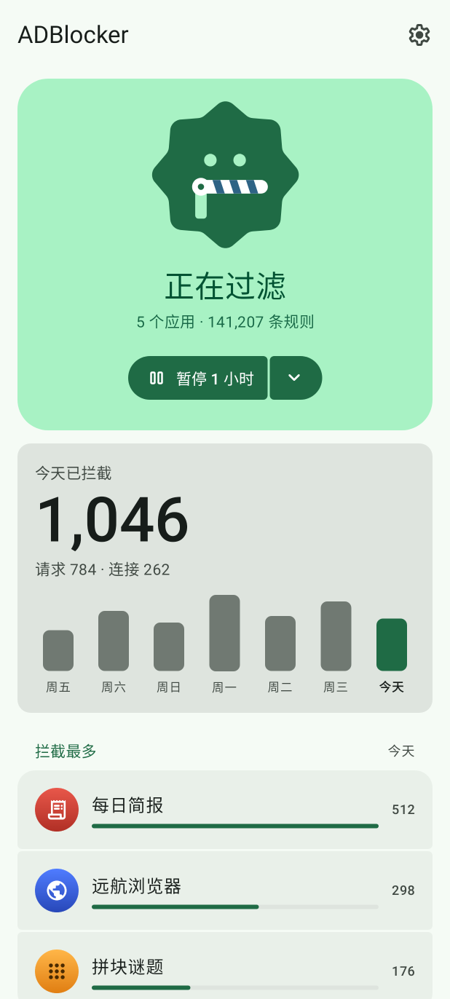
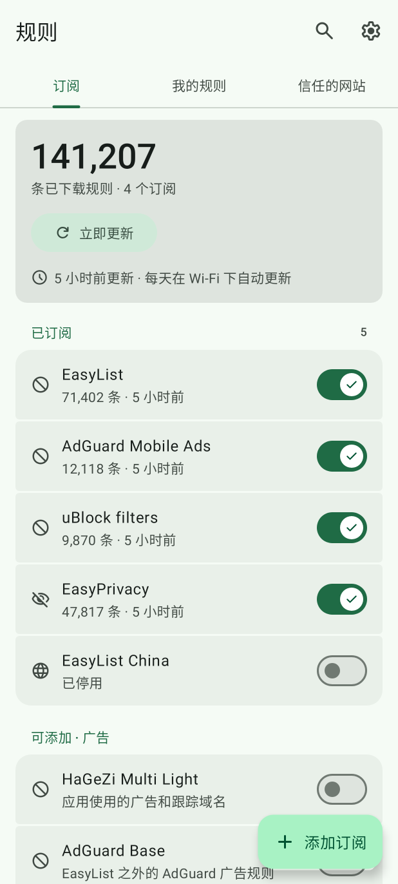

# ADBlocker

[English](README.md) | 简体中文

> 本文译自英文版 README。如内容有出入，以英文版为准。

ADBlocker 是一款运行在本地的 Android 广告拦截工具，直接复用 EasyList、uBlock Origin、AdGuard 等主流浏览器过滤列表来拦截应用内的广告与跟踪器。你可以按需挑选要过滤的应用，也可以一键覆盖全部个人应用。除下载你订阅的过滤列表外，ADBlocker 不收集也不上传任何遥测数据。

  
  
  
  

## root 模式与 VPN 模式对比

ADBlocker 会根据设备是否具备 root 权限，自动采用对应的工作模式：

| | root 模式 | VPN 模式 |
| --- | --- | --- |
| 权限要求 | 需要 root 权限 | 无需 root |
| Android VPN 通道 | 不占用，可与其他 VPN 共存 | 由 ADBlocker 占用 |
| 按网址过滤 HTTPS | 支持已过滤的个人应用；工作应用需由管理员安装 CA 证书 | 安装 ADBlocker 证书后，适用于信任用户证书的应用 |
| DNS 过滤 | 过滤所选应用的明文 DNS 查询 | 过滤所选应用的 DNS 查询 |
| 应用流量归属 | 保留原应用身份（兼容 VPN 和防火墙的按应用规则） | 统一计入 ADBlocker |

在 root 模式下，ADBlocker 不会修改 `/system` 分区，不包含 `post-fs-data` 脚本或 SELinux 规则，且采用故障开放（fail-open）设计：一旦守护进程停止，网络会自动恢复直连，不会导致断网。

## 系统要求

两种模式均要求设备为 64 位架构（`arm64` 或 `x86_64`）。

- **root 模式**：Android 12 及以上、GKI 内核（5.10 及以上）和 root 权限，推荐使用 [KernelSU](https://kernelsu.org)、[Magisk](https://github.com/topjohnwu/Magisk) 或 [APatch](https://apatch.dev)。若使用其他 root 方案，ADBlocker 会在开机后自行拉起 root 模式；如系统限制后台自启，请放行 ADBlocker 的自启动权限。
- **VPN 模式**：Android 10 及以上。

## 安装

1. 前往 [Releases](https://github.com/lihenggui/ADBlocker/releases) 下载并安装 `adblocker-<version>.apk`。
2. 打开 ADBlocker，按引导选择要过滤的应用和过滤列表：
   - **已 root 设备**：应用会自动部署 root 模式并立即生效，无需重启，后续开机自动恢复。
   - **未 root 设备**：应用会启用 VPN 模式并请求创建本地 VPN 连接。

如需从源码自行编译，请参阅 [CONTRIBUTING.md](CONTRIBUTING.md#building)。

> **MIUI / HyperOS 提示**：部分系统默认会隐藏已安装应用列表，直到授予读取权限为止。首次引导和 **应用** 页面都会提供快捷授权入口；在 VPN 模式下，**全部应用** 只能覆盖系统允许 ADBlocker 读取到的应用。

### 作为 root 模块安装

发布页中的 `adblocker-<version>.apk.zip` 与 APK 内容完全一致，只是换了扩展名方便 root 管理器识别。如果你想在 KernelSU、Magisk 或 APatch 中统一管理它，直接刷入 `.apk.zip` 即可（刷入时也会尝试安装应用本体）：

- **KernelSU** 刷入后立即生效。
- **Magisk** 和 **APatch** 需重启后生效。若重启前先打开了 ADBlocker，它会先临时启动 root 模式，重启后由模块无缝接管，原有配置不受影响。

### 更新

直接下载新版 APK 覆盖安装，然后打开一次 ADBlocker 即可完成 root 模式更新。通过 root 管理器刷入的用户，也可以直接在管理器里刷入新版 `.apk.zip`。

### 卸载

- **root 模式（应用内启用）**：请先进入 **设置 › 移除 root 模式**，再卸载应用。该操作会停止过滤，并彻底清理本地 CA 证书及所有数据。
  - 若直接卸载应用，过滤会在约 1 分钟内自动停止；使用 KernelSU、Magisk 或 APatch 时，残留文件与数据会在下次重启时清理；使用其他 root 方案时，这些文件（包括本地 CA）会继续留在设备上，因此务必先在设置中移除。
- **root 模式（root 管理器模块）**：在 root 管理器中卸载模块并重启，再卸载应用。
- **工作资料证书**：如曾为工作应用安装过 CA 证书，请由工作资料管理员手动移除。
- **VPN 模式**：如安装过证书，请在卸载前先进入 **设置 › 移除证书**。卸载应用会删除私钥和应用数据，但 Android 会在系统用户证书库中单独保留证书副本。

## 使用说明

- **概览**：查看当前过滤状态和拦截统计，随时暂停或恢复过滤；若存在尚未下载的已启用列表，也会在此提醒并提供下载入口。
- **应用**：在 **过滤范围** 中选择 **选定应用**（默认）或 **全部应用**，并查看各应用当前的过滤方式。切换到 **全部应用** 后，新安装的个人应用也会自动纳入过滤，个别不需要的应用可随时点 **排除** 或 **重新纳入**。ADBlocker 自身及系统 UID 始终不会被过滤；工作应用仍需逐个手动选择。
- **规则**：管理过滤列表订阅、自定义规则（**我的规则**）以及信任的网站。
- **活动**：点击 **开始录制** 后切回目标应用复现操作，再回来 **停止录制**，即可查看每条请求的命中与放行情况。点开已放行的请求，可以一键仅在该应用或所有应用中拦截对应域名（共享 UID 组仅支持在所有应用中拦截）。录制结果最多在内存中保留最近 500 条，不会写入磁盘。

你还可以把 ADBlocker 添加到系统快捷设置磁贴，解锁屏幕后即可快速暂停/恢复过滤（VPN 模式下也能一键启动 VPN）。HTTPS 过滤配置以及系统的“始终开启的 VPN”入口均位于 **设置** 中。

## 过滤能力

### 域名、网址与 DNS 过滤

- **按网址过滤** 默认开启，在支持 HTTPS 解密或明文 HTTP/1（80 端口）的场景下精确到具体路径——例如拦截 `news.example/ads/banner`，同时放行 `news.example/articles/today`。在 root 模式下，本地 CA 仅对已过滤的个人应用可见；在 VPN 模式下，需先在 **设置** 中安装证书，且只有信任用户证书的应用才会生效。在未完成证书信任或无法解密时，连接保持加密并自动回退为按域名过滤。你也可以随时在 **设置** 中关闭 **按网址过滤**，让全部应用只做域名过滤。
- **路径放行与本地替代**：开启按网址过滤后，若某域名虽被列表拦截，但同时存在针对部分路径的放行规则，引擎会放行连接并逐条检查请求，避免误杀。若规则为被拦截请求指定了内置替代资源，ADBlocker 会在本地返回该资源并计入拦截数。
- **QUIC 回退**：ADBlocker 会拒绝已过滤应用的 QUIC 连接，促使应用回退到 TCP 协议以正常应用 HTTPS 规则。少数强制依赖 QUIC 的应用可能因此无法联网。
- **DNS 过滤**：两种模式均支持拦截已过滤应用的明文 DNS 查询（加密 DNS 相关说明见[限制](#限制)）。

### 页面元素隐藏与高阶规则

**隐藏页面元素** 默认开启，作用于已解密的网页内容，可在 **设置** 中（或通过 `abd cosmetic off`）关闭。支持的规则能力包括：

- **元素隐藏与 HTML 过滤**：支持标准 CSS 隐藏规则（`##`）、`:has-text()` 等程序化规则、AdGuard CSS 注入，以及在页面加载前直接裁剪 HTML 元素的规则（`$$` 与兼容的 uBlock Origin `##^`）。
- **脚本片段与 JS 规则**：内置 uBlock Origin 与兼容的 AdGuard 脚本片段库，并支持受信任官方目录列表与自定义规则中的 AdGuard JavaScript 规则（可通过 `$jsinject` 在指定页面停用）。
- **请求与响应改写**：支持来自自定义规则及受信任目录列表的 `$replace`、`$jsonprune`、`$hls`、`$removeheader`、`$urltransform` 规则，以及任意列表中的 `$cookie`、`$removeparam`、`$csp` 规则。
- **按应用与按 IP 过滤**：支持 `$app=` 按包名、前缀（`*`）或正则匹配目标应用，支持 `$network` 按远端 IP/端口过滤，并支持嵌套的 `!#if` / `!#else` / `!#endif` 条件指令。

各类规则的完整语法、匹配逻辑与信任边界请参阅 [docs/how-it-works.md](docs/how-it-works.md#filtering)。

### 过滤列表

支持 EasyList、uBlock Origin 与 AdGuard 规则格式。首次引导会自动推荐通用列表以及与系统语言、地区或单一国家时区对应的地区列表（当系统语言为中文，或地区为中国大陆、香港、澳门、台湾时，默认勾选 EasyList China、AdGuard Chinese、AWAvenue Ads Rule 与 anti-AD）。

订阅列表会按设定周期在后台自动更新。内置目录会自动选用对应平台构建版本（AdGuard Base、AdGuard Chinese、AdGuard Mobile Ads 使用 Android 版，AdGuard Base 已包含 EasyList；AdGuard Tracking Protection 使用 uBlock Origin 版）。更新时仅处理同一 HTTPS 源和目录内生效的 `!#include` 指令，若任意必需文件下载失败，系统会保留原有完整副本继续生效。

### 共享 UID 与工作资料（root 模式）

- **共享 UID**：同一资料中共享同一个 Android UID 的应用共用一个过滤开关、暂停状态、活动记录与统计数据。开启任一成员即对整组生效，后续新安装的同组成员会自动沿用该组状态。
- **工作资料**：工作应用在 **应用** 列表中带有公文包标识，与个人副本分别独立管理开关、暂停、活动和统计。暂停工作资料不会丢失选择，删除工作资料则会清空对应记录。按域名过滤开箱即用；如需按网址过滤 HTTPS，请在工作应用详情中导出公开证书，交由工作资料管理员安装到对应工作资料（且该应用需信任用户证书）。详见[工作资料中的证书信任](SECURITY.md#work-profiles)。

## 安全与隐私

所有过滤和 HTTPS 检查均在设备本地完成。ADBlocker 不发送任何遥测数据，默认日志也不会记录应用访问过的主机或地址。

开启 **按网址过滤** 解密 HTTPS 流量时，应用或浏览器看到的是 ADBlocker 本地签发的证书而非站点原始证书，因此浏览器的部分校验（如证书透明度 CT、内置证书固定等）将不再适用。对于排除列表中的银行、支付等敏感网站、使用扩展验证（EV）证书的网站，以及启用了证书固定的应用，ADBlocker 会保持其加密连接并自动回退为仅按域名过滤。

关于完整的安全模型与影响，请阅读 [SECURITY.md](SECURITY.md#what-using-it-changes) 及[页面元素隐藏的说明](SECURITY.md#hiding-page-elements)。如不希望解密任何 HTTPS 流量，随时在 **设置** 中关闭 **按网址过滤** 即可。

## 限制

### 通用限制

- 明文 HTTP 过滤仅覆盖发往 80 端口的常规 HTTP/1 请求。
- 当广告与正常内容来自完全相同的网址时，过滤规则无法将二者区分。
- 敏感网站排除列表中的站点、使用 EV 证书的站点，以及启用证书固定的应用，均保持加密并只做域名级过滤。
- 在 **隐藏页面元素** 中，程序化规则可匹配页面加载后动态插入的元素，而仅依赖类名或 ID 的通用 CSS 规则可能会漏掉它们。

### root 模式

- 仅过滤已过滤应用发出的明文 DNS 查询；经 Android“专用 DNS”（指定提供商主机名时始终生效；设为“自动”时在网络支持的情况下生效）或应用自带的加密 DNS（如 DoH）发出的查询不经过滤。若其他应用近期刚查询过同一域名，Android 也可能直接返回系统缓存而不再经过 ADBlocker。开启按网址过滤后，对于能够解密读取请求的主机，仅当过滤列表中不存在可能适用于该主机的网页放行规则时才会在 DNS 阶段拦截，否则留待请求阶段再做判断。
- 对已选中且未暂停的应用，会拒绝发往 443 端口的所有 UDP 流量（包括非 QUIC 协议）。
- `$network` 地址规则仅作用于捕获到的 80 和 443 端口 TCP 连接（关闭按网址过滤时同样生效）。
- 仅支持主用户及其受管理的工作资料，不支持其他多用户。

### VPN 模式

- 占用 Android 唯一的 VPN 通道，启动其他 VPN 应用会中断 ADBlocker。
- Android 系统会将已过滤应用的网络流量统一统计到 ADBlocker 名下。
- 大多数第三方应用默认只信任系统证书，因此通常只能做到域名级过滤，无法进行按网址过滤。
- 仅过滤经系统解析器发出的 DNS 查询（涵盖非 HTTP 流量）；Android 严格模式“专用 DNS”以及应用自带的 DoH 等加密 DNS 会绕过过滤。
- 对已选中且未暂停的应用，会拒绝任意 UDP 端口上识别到的 QUIC 初始包（命中 `$network` 放行规则时除外）。
- `$network` 地址规则覆盖 TCP 和 UDP 目标地址（关闭按网址过滤时同样生效）。对于允许的 TCP 地址，VPN 需在读取到主机名之前先与远端建立连接；若域名规则拦截该主机，VPN 会立即断开连接，不会发送应用数据。

## 常见问题

### 直接装 APK 和在 root 管理器里刷模块有什么区别？

两者的过滤能力完全一致，共用 `/data/adb/adblocker` 下的数据。通过 root 管理器刷入 `.apk.zip` 的好处是可以在管理器列表里直接启停模块（停用模块时即停止过滤）。无论哪种方式，挑选应用和过滤列表都在 ADBlocker 应用内操作。

### 某个应用开启过滤后无法正常使用

先到 **应用** 里点开该应用，**暂停** 过滤 1 小时再试。如果恢复正常，可以直接关掉它的过滤开关；如果想保留过滤并精准放行，先恢复过滤，到 **活动** 中点 **开始录制** 后复现故障，停止录制即可点开被拦截的请求查看命中的规则，选择仅在该应用或所有应用中放行对应域名。如果命中了 **我的规则**，可以直接在详情里删除，或利用操作提示栏里的 **撤销** 按钮回退。反馈问题时请附上受影响的应用名称。

### 应用反复拒绝 HTTPS 过滤

部分应用启用了证书固定（Certificate Pinning），只认自己的指定证书，ADBlocker 检测到后会自动退回域名过滤，并在 **应用** 详情的 **不接受证书的域名** 中列出这些站点。

在装有 LSPosed/Vector 的 root 环境下，可以在 LSPosed/Vector 中为该应用勾选 ADBlocker 模块并重启该应用：应用重新启动后，ADBlocker 会再次尝试对这些站点进行按网址过滤。只有存在证书固定的应用才需要开启 LSPosed/Vector，且该应用仍需在 **应用** 中保持开启过滤。需要注意，拒绝证书未满 1 分钟的站点不会立即重试，且应用建连后从未使用的连接也会记为一次拒绝，因此有时需要等 1 分钟后再重启一次应用。详见 [HTTPS 检查的限制](SECURITY.md#limits-of-https-inspection)。

### 能否与其他 VPN 或代理模块同时使用？

- **root 模式**：可以。由于不占用系统 VPN 通道，可与 Clash Meta 等 VPN 应用同时运行，且转发连接保留原应用身份，VPN 或代理模块的按应用分流规则照常生效。若遇到与特定 VPN 或代理模块组合断网的情况，欢迎提 Issue 反馈具体组合。
- **VPN 模式**：不能。Android 同一时间只允许运行一个 VPN，启动其他 VPN 会停止 ADBlocker；代理模块也会把已过滤应用的流量全部识别为 ADBlocker 的流量。此外，若系统开启了“屏蔽未使用 VPN 的所有连接”，ADBlocker 的 VPN 停止期间所选应用将无法联网。

### 耗电情况如何？

HTTPS 按网址过滤需要在本地对流量进行解密和重新加密，会带来一定 CPU 开销；关闭按网址过滤仅做域名过滤可省去这部分计算。VPN 模式下，所选应用的所有数据包还需经过 ADBlocker 的用户态协议栈转发。

### 数据存放在哪里？

- **root 模式**：`/data/adb/adblocker`（仅 root 可读）。
- **VPN 模式**：ADBlocker 应用的私有目录。

root 命令行参考

可在 root shell 中通过 `abd` 命令管理 root 模式：

- 应用内启用的 root 模式：`/data/adb/adblocker_direct/bin/abd`
- root 管理器刷入的模块：`/data/adb/modules/adblocker/bin/abd`

下文均简写为 `abd`。绝大多数命令支持 `--json` 输出结构化数据；直接运行 `abd` 可查看完整命令列表。

| 命令 | 说明 |
| --- | --- |
| `abd status` | 查看守护进程状态及当前过滤配置。 |
| `abd scope chosen\|all` | 设置个人应用的过滤范围。 |
| `abd app add <package>` | 显式选定一个应用。 |
| `abd app remove <package>` | 取消显式选定。 |
| `abd app exclude <package>` | 在“全部应用”模式下排除某个个人应用；用 `abd app include <package>` 重新纳入。 |
| `abd app list` | 列出当前过滤范围内的应用；加 `--json` 查看实际过滤级别与可用状态。 |
| `abd app selections --json` | 查看过滤范围、已保存的选择和排除项。 |
| `abd app eligibility --json` | 列出个人应用的过滤资格以及各具名共享 UID 组的成员。 |
| `abd app profiles --json` | 列出工作资料序列号、可用包名及共享 UID 组。 |
| `abd ca export` | 导出公开 CA 证书，供工作资料管理员安装。 |
| `abd app pause <package> --minutes <n>` | 暂停过滤单个应用；用 `abd app resume <package>` 提前恢复。 |
| `abd pause [--minutes <n>]` | 暂停过滤所有应用；用 `abd resume` 提前恢复。 |
| `abd url-filtering on\|off` | 全局开启或关闭按网址过滤。 |
| `abd cosmetic on\|off` | 开启或关闭已解密页面的元素隐藏（默认开启）。 |
| `abd allow add <host>` | 将指定主机及其子域名加入信任列表（跳过拦截与解密）；用 `abd allow remove <host>` 和 `abd allow list` 管理。 |
| `abd lists` | 查看已订阅的过滤列表。 |
| `abd list add <url>` | 添加过滤列表订阅；用 `abd list remove\|disable\|enable <url>` 管理。 |
| `abd update` | 立即下载/更新过滤列表。 |
| `abd rules get` | 输出自定义规则；用 `abd rules set` 从标准输入整体替换。 |
| `abd rules append [--unique]` | 从标准输入追加规则；加 `--unique` 时仅在单条规则尚不存在时写入。 |
| `abd rules remove` | 删除与标准输入完全匹配的规则行（忽略首尾空白）。 |
| `abd rules check` | 校验标准输入中的自定义规则，报告每条未生效规则的类别与原因。 |
| `abd pinned` | 列出曾被应用拒绝本地证书的主机；用 `abd pinned forget <package> [<host>]` 在后续连接时重新尝试解密。 |
| `abd reload` | 重新加载过滤列表、自定义规则与应用选择。 |
| `abd stats` | 查看过滤统计数据。 |
| `abd check [--app <package>] <url>` | 测试指定网址是否会被拦截及命中的列表；加 `--app` 时一并计入该应用的专属规则。 |

**指定工作应用与共享 UID：**

- 操作工作应用时，在需要包名参数的位置改用 `<profile-serial>:<package>` 格式（例如 `abd app add 10:com.example.news`）。序列号请以 `abd app profiles --json` 输出为准，它可能与 Android 用户 ID 不同。
- 操作共享 UID 组时，传入组内任意成员包名或组键均可（例如 `abd app pause 10:@com.example.shared --minutes 15`）。

**`/data/adb/adblocker` 目录下的主要配置文件：**

- `sources`：订阅的过滤列表网址，每行一条。尚未保存自定义订阅前该文件不存在，ADBlocker 会自动使用通用列表及匹配的地区列表；默认列表即使未出现在 `sources` 中也会保持开启，在对应网址前加 `#` 可将其关闭。
- `exclusion-sources`：不进行 HTTPS 解密的排除列表网址，每行一条。更新时会自动补全缺失的内置排除源；若排除列表为空，HTTPS 解密将保持关闭。
- `rules/*.txt`：自定义规则文件。手动修改后请运行 `abd update` 或 `abd reload` 使变更生效。

## 工作原理

在 root 模式下，ADBlocker 在接管连接前会先识别发起应用的 UID，并在转发上游连接时沿用同一应用的网络身份；在 VPN 模式下，同一套 Rust 过滤引擎直接运行在应用进程内，通过用户态 TCP/IP 协议栈处理流量。如果你想深入了解一条连接如何从内核路由、HTTPS 证书校验一路流经 [adblock-rust](https://github.com/brave/adblock-rust) 规则引擎，请参阅 [docs/how-it-works.md](docs/how-it-works.md)。

## 多语言支持

ADBlocker 支持英语、简体中文、繁体中文、法语、德语、印尼语、日语、韩语、巴西葡萄牙语、俄语、西班牙语、土耳其语和越南语。应用默认跟随系统语言，Android 13 及以上可在系统设置的“应用语言”中单独切换。欢迎帮助完善各地译文，术语规范与校验要求见 [docs/translations.md](docs/translations.md)。

## 参与贡献

欢迎提交 Issue 和 Pull Request。编译、测试步骤及代码规范请参阅 [CONTRIBUTING.md](CONTRIBUTING.md)，参与社区交流请遵守[行为准则](CODE_OF_CONDUCT.md)。

## 许可证

Copyright (C) 2026 Mercury Li

本程序是自由软件，依据自由软件基金会发布的 GNU 通用公共许可证第 3 版（GPL-3.0-only）发布；你可以按该许可证条款自由分发或修改。详情见 [LICENSE](LICENSE)。

过滤列表及 [AdGuard HTTPS 排除列表](https://github.com/AdguardTeam/HttpsExclusions) 均从各自维护方下载。AdGuard 在其 [`package.json`](https://github.com/AdguardTeam/HttpsExclusions/blob/master/package.json) 中声明排除列表采用 MIT 许可证。上游署名及随版本附带的第三方许可证材料见 [THIRD_PARTY_NOTICES.md](THIRD_PARTY_NOTICES.md)。
