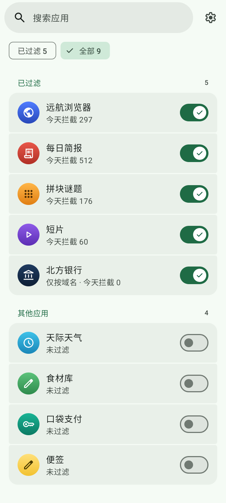
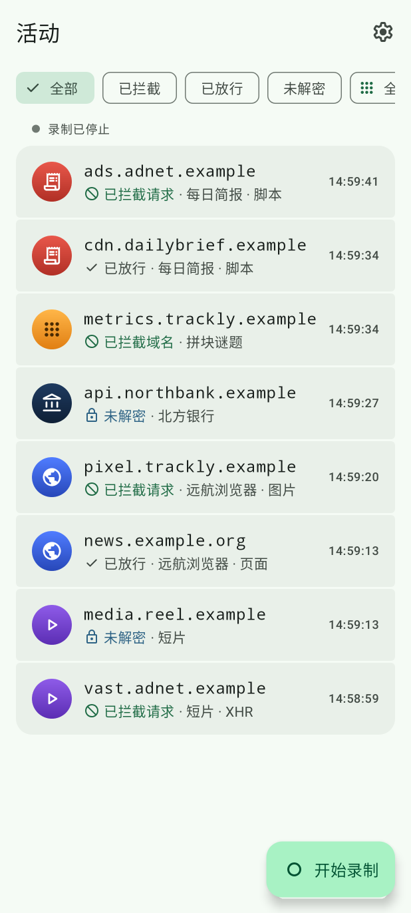

# ADBlocker

[English](README.md) | 简体中文

本文译自英文版 README。两者不一致时，以英文版为准。

ADBlocker 使用浏览器广告拦截器的过滤列表来拦截 Android 应用中的广告和跟踪器，支持 EasyList、uBlock Origin 和 AdGuard 等过滤列表。
可以逐个选择要过滤的应用，也可以过滤全部个人应用。
ADBlocker 会下载已订阅的过滤列表，不发送遥测数据。

  
  
  
  

ADBlocker 有两种过滤方式，取决于设备是否有 root 权限。

| | root 模式 | VPN 模式 |
| --- | --- | --- |
| 所需权限 | root 权限 | 无需 root 权限 |
| Android 的 VPN 名额 | 可供其他 VPN 使用 | 由 ADBlocker 占用 |
| 按网址过滤 HTTPS | 适用于已过滤的个人应用。工作应用需要管理员安装 CA 证书 | 安装 ADBlocker 的证书后，适用于信任用户证书的应用 |
| DNS 过滤 | 已过滤应用的明文 DNS 查询 | 已过滤应用发出的查询 |

在 root 模式下，Android 仍将每条连接归到发起连接的应用，因此 VPN 和防火墙的按应用规则仍然生效。
在 VPN 模式下，已过滤应用的流量经过 ADBlocker 的进程，Android 将这些流量计入 ADBlocker。

## 过滤内容

在 **过滤范围** 中，保留 **选定应用** 可逐个选择要过滤的应用。选择 **全部应用** 可过滤所有符合条件的个人应用，包括之后安装的应用。
在 **应用** 页面使用 **排除** 或 **重新纳入**，可以调整个别应用。
ADBlocker 和系统 UID 不在过滤范围内。工作应用仍需逐个选择。

**按网址过滤** 默认开启。在支持的情况下，网址和资源规则对每个已过滤的应用生效。
例如，规则可以拦截 `news.example/ads/banner`，同时放行 `news.example/articles/today`。
发往 80 端口的普通 HTTP/1 请求无需证书。对于经 TCP 传输的 HTTPS，root 模式会向已过滤的个人应用提供本地 CA 证书。
在 VPN 模式下，需要通过“设置”安装证书。只有信任用户安装的证书的应用才会接受它。
安装前，HTTPS 保持加密，仅应用域名规则。在“设置”中关闭 **按网址过滤**，所有应用都只按域名过滤。
参阅[这对证书信任的影响](SECURITY.md#what-using-it-changes)。

开启按网址过滤后，如果过滤列表拦截某个主机，但也放行该主机的部分路径，该主机仍可访问。此时引擎逐条检查连接中的请求，不会拒绝整条连接。
引擎根据 `Sec-Fetch-Dest` 或网址的文件扩展名判断资源类型。如果两者都无法判断，会在服务器的 `Content-Type` 提供类型时再次检查。
如果规则为被拦截的请求指定了内置替代资源，ADBlocker 会在本地返回该资源，并将该请求计为已拦截。
当网站或应用要求使用 ADBlocker 无法使用的证书时，HTTPS 保持加密，仅应用域名规则。

ADBlocker 拒绝所选应用的 QUIC 连接，使应用可以改用 TCP 重试，继续使用常规 HTTPS 规则。
仅支持 QUIC 的应用可能无法连接。

在 root 模式下，同一资料中被 Android 划入同一个共享 UID 组的应用共用一个开关。
打开任意成员的开关，即为整组开启过滤。新成员沿用该组的选择和暂停状态。
活动和统计数据按组计算一次。

### root 模式下的工作应用

在“应用”页面，公文包图标标出应用的工作副本。每个副本都有独立的选择、暂停状态、活动和统计数据。
如果 Android 暂时无法列出某个工作资料中的应用，可以在“应用”页面点“重试”。此时仍可管理其他应用。
工作资料暂停时，root 模式会保留已选应用。删除工作资料会清除其中的选择和暂停状态，新建的工作资料没有任何选择或暂停记录。

按域名过滤无需证书。要过滤 HTTPS 请求，请保持“按网址过滤”开启，打开工作副本的“设置 HTTPS 过滤”，再把公开证书交给工作资料管理员，由其安装到对应的工作资料中。
工作应用还须对目标站点信任用户证书。应用详情会显示其 HTTP 和 HTTPS 流量的过滤方式。
参阅[工作资料中的证书信任](SECURITY.md#work-profiles)。

## 系统要求

两种方式均需要 64 位 ARM（arm64）或 x86（x86_64）设备。

- root 模式需要 Android 12 或更高版本、GKI 内核（5.10 或更高版本）以及 root 权限。
  可通过 [KernelSU](https://kernelsu.org)、[Magisk](https://github.com/topjohnwu/Magisk) 或 [APatch](https://apatch.dev) 获得 root 权限。
  如果通过其他方式获得 root 权限，ADBlocker 会在设备重启后自行启动 root 模式。如果设备限制应用开机启动，请允许 ADBlocker 自启动。
- VPN 模式需要 Android 10 或更高版本。

## 安装

从[发布页面](../../releases)下载并安装 `adblocker-<version>.apk`。
`adblocker-<version>.apk.zip` 是同一个安装包，使用另一文件名供 root 管理器安装。
如需自行构建，参阅[构建说明](CONTRIBUTING.md#building)。

打开 ADBlocker，选择要过滤的应用和要订阅的列表。有 root 权限时，ADBlocker 会设置 root 模式，立即开始过滤，无需重启设备。此后每次重启都会重新开始过滤。
没有 root 权限时，ADBlocker 会使用 VPN 模式并请求 VPN 权限。

在 MIUI 和 HyperOS 等系统中，ADBlocker 需要获得读取应用列表的权限，才能看到已安装的应用。
首次设置时以及在 **应用** 页面，ADBlocker 会请求这项权限，并可打开 Android 系统设置中的 ADBlocker 页面。
没有 root 权限时，**全部应用** 只过滤 ADBlocker 能从系统读取到的应用。授权前，**概览** 会显示“大部分应用未被过滤”。

首次设置时会推荐通用过滤列表和地区过滤列表。与系统语言或系统区域设置中的地区匹配的地区列表默认开启。如果系统时区只对应一个国家，也会默认开启与该国匹配的地区列表。
系统语言为中文，或地区为中国大陆、香港、澳门或台湾时，EasyList China、AdGuard Chinese、AWAvenue Ads Rule 和 anti-AD 默认开启。

ADBlocker 会保存选定的订阅，下载过滤列表，并按设定的间隔在后台更新。
只处理指向列表所在 HTTPS 源和目录内文件的生效 `!#include` 指令。
每次更新都会将整个列表连同它引用的文件一起替换。如果有必需的文件下载失败，继续使用旧副本。
AdGuard Base、AdGuard Chinese 和 AdGuard Mobile Ads 使用各自的 Android 版。AdGuard Base 包含 EasyList。
AdGuard Tracking Protection 使用其 uBlock Origin 版。要通过 root shell 下载过滤列表，运行 `abd update`。

### 作为模块安装

同一个文件也可作为 KernelSU、Magisk 和 APatch 的模块安装。
要在 root 管理器中查看和管理 root 模式，请在其中安装 `.apk.zip`。此操作也会尝试安装应用。
KernelSU 会立即应用模块，Magisk 和 APatch 会在设备重启后应用模块。
如果在重启前打开 ADBlocker，它会自行设置 root 模式。重启后，模块接管，并沿用同一套设置。

### 更新

用新的 APK 覆盖安装，再打开 ADBlocker，应用会更新 root 模式。
在 root 管理器中安装的模块也可在该管理器中用新的 `.apk.zip` 更新。

### 卸载

在 root 模式下，先进入 **设置 › 移除 root 模式**，再卸载应用。
移除 root 模式会停止过滤，并删除其证书颁发机构及其他数据。
如果 ADBlocker 是作为模块安装的，请在 root 管理器中移除模块，再重启设备。
若为工作应用过滤安装过 CA 证书，请由工作资料管理员移除。

如果先卸载应用，由 ADBlocker 设置的 root 模式会在约 1 分钟内停止过滤。
装有 KernelSU、Magisk 或 APatch 时，模块的文件和数据会在下次重启时删除。
如果通过其他方式取得 root 权限，这些文件和数据会保留，包括证书颁发机构。因此应先在“设置”中移除 root 模式，再卸载应用。

在 VPN 模式下，如果安装过 ADBlocker 的证书，请在卸载应用前进入 **设置 › 移除证书**。
卸载会删除私钥和应用数据。Android 单独存储证书。

## 使用方法

- **概览** 显示过滤状态和拦截的请求，也可暂停或恢复过滤。
  如果某个已启用的过滤列表从未下载，页面会提示该列表尚未参与过滤，并提供下载入口。
- **应用** 列出已安装的应用及其过滤方式。
- **规则** 用于管理订阅、自定义规则和信任的网站。支持 EasyList、uBlock Origin 和 AdGuard 等过滤列表。
- 在 **活动** 中点“开始录制”后，ADBlocker 会记录请求。切换到已过滤的应用，重复要检查的操作，然后点“停止录制”，即可查看当前规则如何处理各条请求。
  打开一条已放行的请求，可选择仅在该应用中拦截其域名，或选择“在所有应用中拦截”。新增规则会保存到 **规则** 中的 **我的规则**。
  对于共享 UID 组的请求，只能在所有应用中拦截。最近 500 条请求保留在内存中，直到开始下一次录制或 ADBlocker 退出。

快捷设置磁贴可以暂停和恢复过滤，在 VPN 模式下也可以启动 VPN。这些操作需要先解锁设备。
“设置”提供 HTTPS 过滤的设置入口，也可打开 Android 的“始终开启的 VPN”设置。

root 命令行参考

在 root shell 中运行 `abd` 可管理 root 模式。由 ADBlocker 设置 root 模式时，路径为 `/data/adb/adblocker_direct/bin/abd`。
作为模块安装时，路径为 `/data/adb/modules/adblocker/bin/abd`。下文用 `abd` 代替完整路径。

| 命令 | 作用 |
| --- | --- |
| `abd status` | 显示守护进程的状态和当前的过滤配置。 |
| `abd scope chosen\|all` | 设置个人应用的过滤范围。 |
| `abd app add <package>` | 明确选定一个应用。 |
| `abd app exclude <package>` | 从“全部应用”过滤范围中排除某个个人应用。用 `app include` 将其重新纳入。 |
| `abd app remove <package>` | 取消对某个应用的选定。 |
| `abd app list` | 列出过滤范围内的应用。用 `--json` 查看实际生效的过滤级别及可用状态。 |
| `abd app selections --json` | 显示过滤范围、已保存的选择及排除项。 |
| `abd app eligibility --json` | 列出个人应用是否符合过滤条件，以及每个具名组的成员。 |
| `abd app profiles --json` | 列出工作资料序列号、符合条件的应用包及共享 UID 组。 |
| `abd ca export` | 输出公开的 CA 证书，供工作资料管理员使用。 |
| `abd app pause <package> --minutes <n>` | 暂停过滤某个应用。用 `abd app resume <package>` 提前恢复。 |
| `abd pause [--minutes <n>]` | 暂停过滤所有应用。用 `abd resume` 提前恢复。 |
| `abd url-filtering on\|off` | 为所有已过滤的应用开启或关闭按网址过滤。 |
| `abd cosmetic on` | 隐藏已解密页面中匹配规则的元素。默认开启。用 `off` 关闭。 |
| `abd allow add <host>` | 对指定主机及其子域名跳过拦截和解密。用 `abd allow remove <host>` 和 `abd allow list` 管理这些条目。 |
| `abd lists` | 列出过滤列表。 |
| `abd list add <url>` | 订阅过滤列表。用 `remove`、`disable` 或 `enable` 加上同一网址进行管理。 |
| `abd update` | 下载过滤列表。 |
| `abd rules get` | 输出自定义规则。用 `abd rules set` 从标准输入读取规则并替换现有规则。 |
| `abd rules append [--unique]` | 从标准输入追加规则。指定 `--unique` 时，只在单条规则尚不存在时添加它。 |
| `abd rules check` | 检查标准输入中的自定义规则，报告每条未应用规则的类别和原因。 |
| `abd pinned` | 列出应用曾拒绝接受本地证书的主机。用 `abd pinned forget <package> [<host>]` 可以在之后连接时重新尝试解密。 |
| `abd reload` | 重新读取过滤列表、规则和应用。 |
| `abd stats` | 显示过滤统计数据。 |
| `abd check [--app <package>] <url>` | 检查过滤列表是否拦截某个网址，并指出匹配的列表。指定 `--app` 时，也会考虑该应用适用的规则。 |

对于工作应用，凡是接受应用参数的命令，都使用 `<profile-serial>:<package>` 格式，例如 `abd app add 10:com.example.news`。
序列号以 `abd app profiles --json` 的输出为准，可能与 Android 用户 ID 不同。

对于共享 UID，可以用组内任意成员的包名或组键指定选择。
例如，`abd app pause 10:@com.example.shared --minutes 15` 会暂停过滤工作资料 10 中的这个组。

大多数命令接受 `--json`，以应用使用的格式输出结果。不带参数运行 `abd` 可查看全部命令。

在 `/data/adb/adblocker` 中，`sources` 保存过滤列表的地址，`exclusion-sources` 保存列出不解密主机的列表地址，每行一个。
选定过滤列表之前，`sources` 不存在。此时使用通用列表，以及与系统语言和地区、时区匹配的地区列表。
这些默认列表即使未列在 `sources` 中也会开启。在列表地址前加 `#` 可以关闭它。
更新时会将缺少的内置排除列表源补入现有选择。如果未选任何排除列表，解密保持关闭。
自定义规则保存在 `rules/*.txt`，语法与过滤列表相同。
ADBlocker 使用 uBlock Origin 发布的过滤列表。过滤列表和自定义规则均支持嵌套的 `!#if`、`!#else` 和 `!#endif` 指令，可使用 `!`、`&&`、`||` 和括号。
`adguard`、`adguard_app_android`、`ext_ublock`、`env_mobile`、`env_chromium` 和 `cap_html_filtering` 为真。
`cap_user_stylesheet`、`false` 和其他所有名称都求值为假。
`abd rules check` 会报告未解析的生效包含指令和格式错误的条件指令。自定义规则中的包含指令不会解析。
`--json` 输出中，每个问题也包含相同的类别和原因。

开启按网址过滤时，匹配的 `$replace` 规则可以覆盖对请求的拦截，并改写文本响应。
匹配的 `$jsonprune` 规则会移除 JSON 或 JSONP 响应中的条目，请求拦截仍然生效。
匹配的 `$hls` 规则会从 HLS 播放列表中移除片段及其关联的标签。
`$removeheader=header-name` 移除响应头，`$removeheader=request:header-name` 移除请求头。
`$urltransform` 规则可以在请求发出前修改路径和查询部分，也可以将 GET 或 HEAD 请求重定向到其他地址。
文本响应规则、移除标头的规则和网址转换规则来自自定义规则和订阅目录中受信任的列表。

开启按网址过滤时，任何列表都可以用 `$cookie` 移除 Cookie，或修改其过期时间和 SameSite 属性。
`$removeparam=name` 会在发出已放行的请求之前移除指定名称的查询参数。
`$csp` 为已放行的页面添加内容安全策略。
参阅[网址和响应规则](docs/how-it-works.md#filtering)。

`$app=` 接受包名、以 `*` 结尾的前缀，以及用 `/` 括起的正则表达式。
用 `|` 分隔各项。在每项前加 `~` 可排除匹配的应用。
正则表达式中的 `/`、`$`、`,` 和 `|` 要用反斜杠转义。

`$network` 规则根据远端 IP 地址过滤连接，也可指定端口。IPv6 地址须放在方括号中。
用 `/` 括起正则表达式，查找匹配时会分别检查带端口和不带端口的地址。
精确地址模式也可以用 `|` 或 `||` 开头。
`@@` 放行匹配的连接，不再进行后续过滤。
只有 `$app` 和 `$important` 修饰符可以与 `$network` 同用。标记为重要的拦截规则优先于例外规则。
修改后运行 `abd update` 或 `abd reload`。

## 常见问题

### APK 与 root 管理器中的模块

两者使用相同的过滤方式，并共用 `/data/adb/adblocker` 中的数据。
刷入的模块也会出现在 root 管理器中，只有在管理器中启用该模块才会过滤。
两种安装方式都在应用内选择要过滤的应用和要订阅的列表。默认使用 **选定应用**，只有在 **应用** 中打开开关的应用才会过滤。

### 已过滤的应用无法正常工作

在 **应用** 中打开对应的条目，暂停过滤 1 小时，然后重试。如果问题消失，可以继续关闭该应用的过滤。
要找出涉及的规则，先恢复过滤，再到 **活动** 中开始录制，并重复之前失败的操作。
停止录制后，打开一条被拦截的请求，可以查看详情，或在发出请求的应用或所有应用中放行该域名。
如果提交问题报告，请附上受影响的应用名称。

### 应用反复拒绝 HTTPS 过滤

有些应用对某个网站只接受其指定的证书。此时，ADBlocker 只对这些应用按域名过滤。
在 **应用** 中打开对应的条目，可在 **不接受证书的域名** 下查看这些网站。
在使用 LSPosed/Vector 的 root 模式下，请在 LSPosed/Vector 中为该应用启用 ADBlocker，再重启该应用。
应用启动时，ADBlocker 会对这些网站重试，之后按网址过滤。
只有这类应用才需要 LSPosed/Vector，并且要在 **应用** 中保持开启过滤。
如果应用拒绝某网站的证书还不到 1 分钟，ADBlocker 暂时不会重试。应用打开后从未使用的连接也算作拒绝，因此可能需要等 1 分钟再重启一次应用。
参阅[这样做的影响](SECURITY.md#limits-of-https-inspection)。

### 使用 VPN 或代理模块

root 模式不占用 Android 的 VPN 名额，可以同时使用 Clash Meta 等 VPN 应用。
Android 将转发的连接归到原应用，因此 VPN 或代理模块的按应用规则对这些连接生效。
如果使用某个 VPN 或代理模块时，有已过滤的应用无法联网，请提交问题报告并说明这个组合。

VPN 模式占用 Android 唯一的 VPN 名额。启动其他 VPN 会停止 ADBlocker 的 VPN。
代理模块会将已过滤应用的流量识别为 ADBlocker 的流量。
如果 Android 开启了“屏蔽未使用 VPN 的所有连接”，所选应用在 VPN 停止期间无法访问网络。

### 耗电

检查 HTTPS 连接时，需要在设备上解密流量，再重新加密。按域名过滤无需做这两步。
在 VPN 模式下，所选应用的每个数据包还会经过 ADBlocker 的进程。

### 数据存储位置

root 模式下，数据存放在 `/data/adb/adblocker`，只有 root 能读取。
VPN 模式下，数据存放在应用的私有目录。

## 安全

按网址过滤允许 ADBlocker 在设备上读取 HTTPS 请求。
当 ADBlocker 解密浏览器的连接时，浏览器看到的是 ADBlocker 为该网站提供的证书，浏览器通常执行的部分安全检查不再适用。
参阅 [HTTPS 过滤带来的变化](SECURITY.md#what-using-it-changes)。
关闭 **按网址过滤** 可让 HTTPS 保持加密。

## 限制

- **隐藏页面元素** 会在已解密的网页上隐藏过滤列表指定的元素，例如空白广告框。
  AdGuard 的 `$$` 规则和兼容的 uBlock Origin `##^` 规则会在页面加载前从 HTML 中移除元素。
  这项设置默认开启，可在“设置”中关闭，也可在 root shell 中运行 `abd cosmetic off` 关闭。
  此功能还会运行受支持的 uBlock Origin 和 AdGuard 脚本片段、带有相应标记的列表及自定义规则中的 AdGuard JavaScript 规则、AdGuard CSS 注入规则，以及 `:has-text()` 等程序化规则。
  `$jsinject` 页面例外会在匹配的页面上停用脚本片段和 JavaScript 规则。
  程序化规则也能匹配网页后来添加的元素，仅依靠类名或 ID 的通用 CSS 规则可能漏掉这些元素。
  参阅[这对网页的影响](SECURITY.md#hiding-page-elements)。
- 明文 HTTP 过滤覆盖发往 80 端口的普通 HTTP/1 请求。
- 对于敏感网站列表中的网站，按网址过滤会退回到仅按域名过滤。这些列表包括银行和支付服务。
  应用为某个网站指定证书或密钥，或者网站使用扩展验证证书时，也同样只按域名过滤。
- 规则无法区分来自同一地址的广告和内容。
- root 模式会拦截已过滤应用的明文 DNS 查询中命中规则的域名，无论查询由 Android 的解析器发出，还是由应用自行发出。
  Android 经“专用 DNS”发出的查询不经过滤。指定提供商主机名时，Android 始终通过“专用 DNS”发送查询。选择“自动”时，只有网络的 DNS 服务器支持才会使用。
  应用自行发出的加密 DNS 查询（例如 DoH）也不经过滤。
  如果另一个应用最近查询过某个域名，Android 可以直接用缓存回答，无需询问 ADBlocker。
  开启按网址过滤后，如果该应用与某主机的连接保持加密，例如网站在排除列表中，或应用为其固定了证书，就按域名规则判断是否拦截查询。
  如果 ADBlocker 能读取发往该主机的请求，只有当过滤列表中没有任何网页例外规则可能适用于该主机时，才按域名规则拦截查询。否则，改为过滤请求。
- root 模式仅支持主用户及其受管理的工作资料。共享 UID 的应用在同一资料中共用一套选择和暂停状态。

VPN 模式下：

- VPN 会对所选应用通过系统解析器发出的 DNS 查询拦截命中规则的域名，包括 HTTP 和 HTTPS 以外的流量所需的查询。
  Android 的“专用 DNS”设为“专用 DNS 提供商主机名”时，以及应用自行使用 DoH 等加密 DNS 时，查询会绕过 VPN 的 DNS 过滤。
- 过滤 HTTPS 请求需要受信任的用户证书。大多数应用只接受系统证书，因此只按域名过滤。
- 对于已选中且未暂停过滤的应用，无论使用哪个端口，VPN 都会拒绝识别出的 QUIC 连接的第一个数据包。
  root 模式会对这些应用拒绝发往 443 端口的所有 UDP 流量，包括 QUIC 之外的协议。
  命中 VPN 地址例外时，也会跳过 QUIC 拒绝。
- 关闭按网址过滤后，地址规则仍然生效。VPN 模式检查 TCP 和 UDP 的目标地址，另行处理发往其虚拟解析器的查询。
  root 模式检查捕获的、发往 80 和 443 端口的 TCP 连接的目标地址。
- 检查完地址规则后，VPN 会在收到主机名之前与服务器建立 TCP 连接。
  如果域名规则拦截该主机，VPN 会关闭连接，不发送应用数据。
- 系统的“流量使用情况”将所选应用的流量计入 ADBlocker。
- 无法同时使用另一个 VPN。

## 工作原理

在 root 模式下，ADBlocker 会先查找发起连接的应用的 UID，再将连接交给过滤器。
向网站建立连接时，ADBlocker 使用同一应用的网络身份。
[设计说明](docs/how-it-works.md)以一条连接为例，说明它如何从内核经过 HTTPS 检查，再到[规则引擎](https://github.com/brave/adblock-rust)。

## 语言

ADBlocker 支持英语、简体中文、繁体中文、法语、德语、印尼语、日语、韩语、巴西葡萄牙语、俄语、西班牙语、土耳其语和越南语。
应用使用系统语言。在 Android 13 或更高版本中，可以在系统设置的“应用语言”中为 ADBlocker 选择其他语言。
欢迎母语使用者指正。[Android 翻译说明](docs/translations.md)列出了各语言的术语，以及修改须通过的检查。

## 参与贡献

欢迎提交问题报告和拉取请求。构建、测试和项目约定见 [CONTRIBUTING.md](CONTRIBUTING.md)。

## 许可证

Copyright (C) 2026 Mercury Li

本程序是自由软件。你可以依照自由软件基金会发布的 GNU General Public License 第 3 版的条款，重新分发本程序、修改本程序，或同时进行这两项操作。参阅 [LICENSE](LICENSE)。

过滤列表和 [AdGuard HTTPS 排除列表](https://github.com/AdguardTeam/HttpsExclusions)从各自的维护方下载。
AdGuard 在其 [`package.json`](https://github.com/AdguardTeam/HttpsExclusions/blob/master/package.json) 中声明，排除列表项目采用 MIT 许可证。
上游署名及随版本分发的许可证材料见[第三方声明](THIRD_PARTY_NOTICES.md)。
